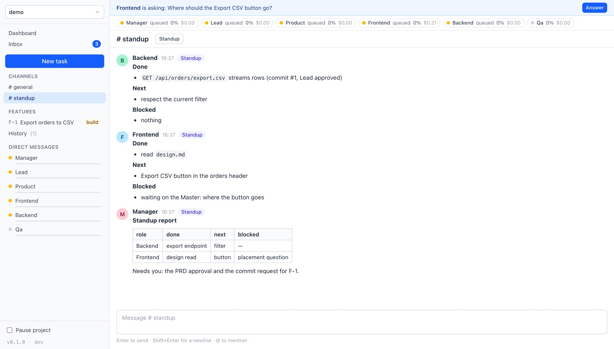
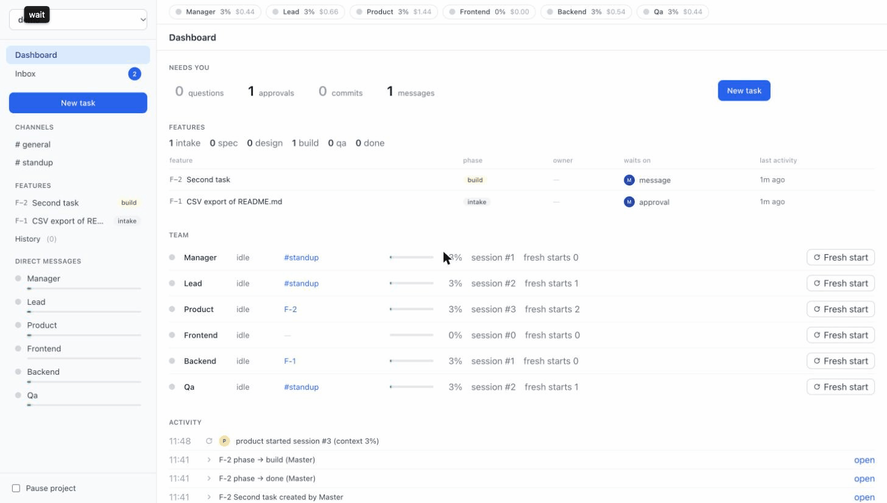

# AITeams

A local "Slack of AIs": six role-based Claude Code sessions (Manager, Lead, Product, Frontend,
Backend, QA) that work as an engineering team on your own repos. You are the **Master**: you
hand out tasks, answer questions, approve scope and commits, and watch everything from a light,
flat web UI. Runs entirely on your machine with your Claude Team login. No API key, no cloud, no
GitHub integration.


## What it does

- **Features, not tickets.** A task becomes a feature `F-<n>` with its own conversation and a folder
  of living docs (`prd.md`, `design.md`, `test-plan.md`). The phase (intake → done) is a label any role
  can set; there is no pipeline to wait on.
- **Roles that behave like a team.** Product writes the PRD and asks you to lock scope. Lead designs
  and reviews every commit. Backend/Frontend build. QA writes the test plan and files bugs. Manager
  routes, chases, runs standups and keeps your attention cheap.
- **You stay in control.** Agents never commit or push. They request a commit with exact files; the
  Lead reviews it; you approve it from your Inbox and the daemon commits in your name. Hooks enforce
  file locks (one role per file per turn) and deny `git commit`/`push` regardless of what a role tries.
- **Inbox** collects only what needs you: questions, approvals, commits ready to land, blockers.
- **Sessions stay small.** The daemon tracks each role's context; past 60% the role writes a handoff
  and continues in a fresh session seeded from it. You can also Stop a running agent or give any role
  a fresh start, and the Manager can do the same through tools.
- **Standup on demand.** One click (or the Manager's own call) asks the roles that were active for
  Done/Next/Blocked, and the Manager compiles a report. Nothing scheduled, nothing nags you.
- **Live session view.** Every role's DM has a tab showing its Claude Code session as it runs: tool
  calls, diffs, command output, the exact prompt it was given.




## How it works

```
aiteams (CLI) ──registers folder──▶ daemon (FastAPI + React UI, 127.0.0.1:7700)
                                        │  SQLite per project: <repo>/.aiteams/state.db
                                        │  wake queue · scheduler (max 3 concurrent, Master first)
                                        ▼
                     per turn:  claude -p --resume <role session> ... --mcp-config <aiteams tools>
                                        │  roles talk to chat ONLY through MCP tools
                                        │  PreToolUse hook: file locks, deny git commit/push
                                        ▼
                             stream-json events → DB + websocket → Live session tab
```

- **Spawn per turn.** A role is woken when it is @mentioned or DM'd. Each wake spawns one headless
  `claude -p` process that resumes the role's session, acts, and exits. Idle roles cost nothing.
- **Isolation.** Roles run with `--setting-sources local`, their own hooks and MCP config, and a
  role prompt + shared team rules appended to the system prompt. Your global `~/.claude` config does
  not leak in.
- **Everything is a file.** Specs, designs, handoffs and standup reports live under `<repo>/.aiteams/`
  (git-excluded via `.git/info/exclude`), so a role can always re-read the truth instead of trusting
  its memory.

The full decision log is in [`BRAINSTORM.md`](BRAINSTORM.md); the milestone specs are in
[`SPEC.md`](SPEC.md) and [`specs/`](specs/).

## Requirements

- macOS or Linux, Python 3.12+, [uv](https://docs.astral.sh/uv/), Node ≥ 22.12 with npm (24 LTS recommended,
  e.g. `brew install node@24`): `aiteams upgrade` builds the UI.
- [Claude Code](https://docs.claude.com/en/docs/claude-code) CLI installed and logged in with a
  Claude Team plan (that is what it was built and tested with; no API key is used). Agents share your plan's usage window; the daemon pauses the team when
  the limit is hit and tells you.
- A git repository to work on (several linked repos per project are planned, not built yet).

## Install

```bash
git clone <this repo> ~/AITeams && cd ~/AITeams
uv tool install .      # bootstrap: puts a first `aiteams` on PATH
aiteams upgrade        # snapshots HEAD into ~/.aiteams/runtime/<sha>/ and runs the daemon from it
```

The daemon never runs from the checkout: `aiteams upgrade [ref]` takes a `git archive` of the source
repo (HEAD by default, any ref works and an older ref is the rollback), installs it as a non-editable
tool and restarts the daemon. Edits in the checkout, by you or by the team, take effect only on the
next `aiteams upgrade`. The UI build output (`aiteams/static/`) is not committed: `upgrade` runs
`npm ci` + `npm run build` inside the snapshot before it stops the daemon, so a missing Node or a broken
build aborts with the old daemon still running.

**Crossing into M2c** (the release that moved the UI build into `upgrade`): the `aiteams` on PATH is
whatever the last upgrade installed, and a pre-M2c one has no build step. Run the first upgrade to M2c,
and every roll-forward after a rollback to a pre-M2c ref, from the checkout:
`uv run --no-sync python -B -m aiteams.cli upgrade` (or run `aiteams upgrade` twice).

UI development (in `ui/`): `npm ci` once, `npm run dev` (Vite dev server, proxies the daemon), `npm run
build` (writes the gitignored `aiteams/static/` for local checks), `npm run e2e:install` once per
Playwright version, `npm run e2e` (build + Playwright suite against a sandbox daemon) and
`npm run shot -- /p/demo` (PNG of a route). The sandbox is `scripts/qa_sandbox.py` on ports 8790–8799; it
never touches `~/.aiteams` or the live daemon. See the [guide](docs/GUIDE.md#ui-development-and-qa).

## Use

```bash
cd ~/code/my-project     # any git repo
aiteams                  # starts the daemon if needed, registers the folder, opens the UI
```

Then click **New task**, describe what the team should do, and pick who starts (Product by default).
Watch the Inbox, answer when asked, approve the scope and the commits. The
[user guide](docs/GUIDE.md) walks through every screen and action; the GIF below is a quick tour.



Useful commands:

```bash
aiteams status           # daemon pid, port, running turns, running version and whether an upgrade is available
aiteams stop             # stop the daemon (running turns are interrupted and re-queued)
aiteams upgrade [ref]    # snapshot + reinstall + restart on <ref> (default HEAD); `aiteams upgrade HEAD~1` rolls back
aiteams token            # print the Master token; --link prints a sign-in URL; --rotate replaces it (open tabs sign out)
```

Every `/api` route and the websocket need the Master token from `~/.aiteams/token` (`GET /api/health`
is open). `aiteams` opens the browser through a single-use sign-in link that sets a cookie; from a
terminal send it as a bearer header. Settings live in `~/.aiteams/settings.json` (`default_model`,
per-role `models`, `max_concurrent`, `rotate_pct`, `stale_hours`, timeouts):

```bash
curl -X PUT 127.0.0.1:7700/api/settings -H "Authorization: Bearer $(cat ~/.aiteams/token)" \
  -H 'content-type: application/json' -d '{"default_model": "opus", "max_concurrent": 3}'
```

## Project layout

```
aiteams/            daemon, CLI, SQLite schema, scheduler/turn runner, MCP server, hook, role prompts
aiteams/roles/      manager.md, lead.md, ... and team-rules.md (override per project in .aiteams/roles/)
ui/                 React 19 + Vite + Tailwind 4 + shadcn-style kit on Radix + Redux Toolkit, built into aiteams/static/ by upgrade
ui/e2e/             Playwright suite + screenshot command, run against scripts/qa_sandbox.py
tests/              pytest suite (no real claude needed; a fake child process stands in)
scripts/            QA sandbox daemon + end-to-end verification walkthroughs run against the real CLI
specs/, SPEC.md     milestone specs; BRAINSTORM.md is the decision log
docs/               this guide, screenshots, walkthrough GIF
```

## Status

- **M1 (done):** daemon + CLI, chat with typed messages and read receipts, six roles with live session
  view, features with living docs, approvals, commit flow with Lead review, file locks, Inbox,
  dashboard, session rotation with handoffs, Stop/interrupt/checkpoint, on-demand standup, feature
  fresh start, History.
- **M2a (done):** `aiteams upgrade` runtime snapshot, Master token on `/api` and `/ws`, per-turn secret on
  `/internal`, schema migrations, so the team can safely edit this repo while the daemon runs it.
- **M2b (done):** first dogfood run: the team built toast notifications and the commit review view.
- **M2c (done):** UI build moved into `aiteams upgrade`, React 19 / Vite 8 / Tailwind 4 / shadcn-style Radix kit with
  a four-step type scale, Redux Toolkit store, QA sandbox + Playwright suite.
- **Next:** the team dogfoods the M2c task list (project notes for roles, a better diff view, ...).

Personal project. Issues and ideas welcome; expect rough edges.

## License

Apache License 2.0. See [LICENSE](LICENSE) and [NOTICE](NOTICE).
