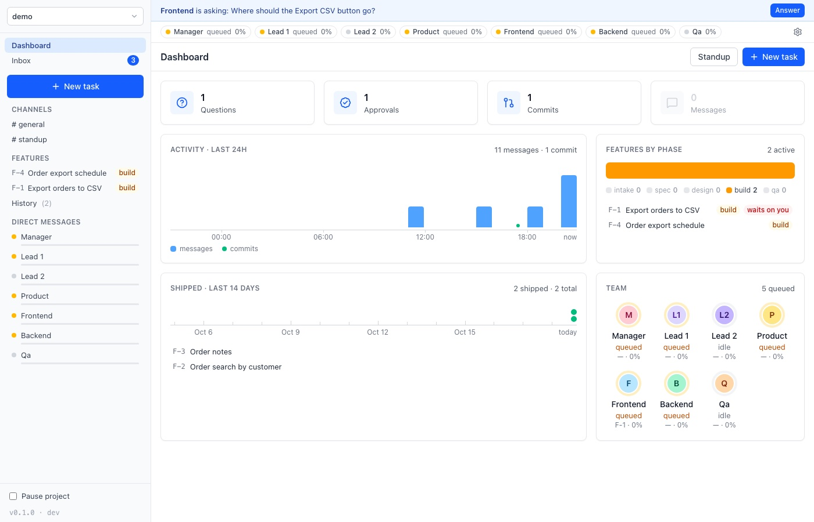
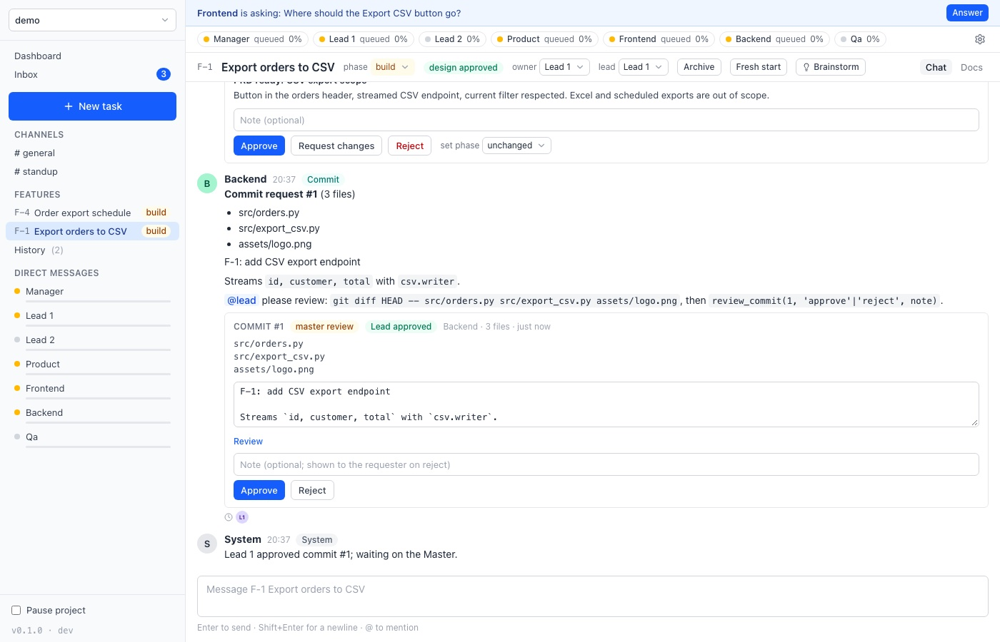
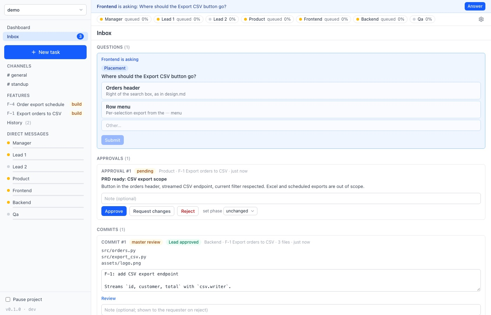

# AITeams

A local "Slack of AIs": seven role-based Claude Code sessions (Manager, Lead 1, Lead 2, Product, Frontend,
Backend, QA) that work as an engineering team on your own repos. You are the **Master**: you hand out
tasks, answer questions, approve scope, designs and commits, and watch everything from a light, flat web
UI. Runs entirely on your machine and drives your own signed-in Claude Code CLI. No cloud service, no
GitHub integration.

AITeams is an independent project. It is not affiliated with or endorsed by Anthropic.



## What it does

- **Features, not tickets.** A task becomes a feature `F-<n>` with its own conversation and a folder of
  living docs (`prd.md`, `design.md`, `test-plan.md`). The phase (intake → done) is a label any role can
  set; there is no pipeline to wait on. Each feature has one of the two Leads, so two features can move
  at once.
- **Roles that behave like a team.** Product interviews you and writes the PRD, the Lead designs the
  feature and reviews the other roles' commits, Backend/Frontend build, QA writes the test plan and checks the result, and the
  Manager routes work, chases what is stuck and runs standups. Roles push back once with their own
  opinion, then do what you decide.
- **Questions come as cards.** Anything that needs your answer is a card with options: a question, an
  A-vs-B choice with both sides argued, or a concern. The **Brainstorm** button on a feature asks every
  role involved for ideas and Product compiles them into one card for you.
- **You stay in control.** Agents never commit or push. You approve the scope (PRD) and the design before
  building starts; until the design is approved, commit requests are refused. A role requests a commit with
  exact files and the Lead reviews it; linked requests form a commit group that lands all at once, in
  order. You approve or reject from the Inbox and the daemon commits in your name. A hook takes a file lock
  on every edit (one role per file per turn) and denies `git commit`/`push` commands: guardrails against
  accidents, not a sandbox.
- **Inbox** collects only what needs you: questions, approvals (Approve / Request changes / Reject),
  commits ready to land, blockers.
- **Dashboard** shows what needs you, the last 24 hours of activity, features by phase, what shipped in
  the last 14 days and where every role is.
- **Role settings** (gear in the top bar): model and effort per role, and the Claude Code plugins role
  turns load, each optionally marked "Ask me first" so a role must get your approval before using one of
  that plugin's skills.
- **Sessions stay small.** The daemon tracks each role's context; past 60% the role writes a handoff and
  continues in a fresh session seeded from it. You can Stop a running agent or give any role a fresh
  start.
- **Standup on demand.** One click (or the Manager's own call) asks the roles that were active for
  Done/Next/Blocked, and the Manager compiles a report. Nothing scheduled, nothing nags you.
- **Live session view.** Every role's DM has a tab showing its Claude Code session as it runs: tool
  calls, diffs, command output, the exact prompt it was given.
- **Small things:** read receipts, roles' emoji reactions on messages, toasts for what needs you, and on macOS the machine
  stays awake while a role is working.





## How it works

```
aiteams (CLI) ──registers folder──▶ daemon (FastAPI + React UI, 127.0.0.1:7700)
                                        │  SQLite per project: <repo>/.aiteams/state.db
                                        │  wake queue · scheduler (max 3 concurrent, Master first)
                                        ▼
                     per turn:  claude -p --resume <role session> ... --mcp-config <aiteams tools>
                                        │  roles talk to chat ONLY through MCP tools
                                        │  PreToolUse hook: file locks, deny git commit/push
                                        ▼
                             stream-json events → DB + websocket → Live session tab
```

- **Spawn per turn.** A role is woken when it is @mentioned or DM'd. Each wake spawns one headless
  `claude -p` process that resumes the role's session, acts, and exits. Idle roles cost nothing.
- **Isolation.** Roles run with `--setting-sources local`, their own hooks and MCP config, and a
  role prompt + shared team rules appended to the system prompt. Your global `~/.claude` config does
  not leak in.
- **Everything is a file.** Feature docs, handoffs and standup reports live under `<repo>/.aiteams/`
  (added to `.git/info/exclude`), so a role can always re-read the truth instead of trusting its
  memory. Lasting knowledge about the codebase goes in `<repo>/.project-notes/`, one topic per file.

Improvements that are decided but not built yet are in [`IMPROVEMENTS.md`](IMPROVEMENTS.md).

## Requirements

- macOS or Linux, Python 3.12+, [uv](https://docs.astral.sh/uv/), Node ≥ 22.12 with npm (24 LTS recommended,
  e.g. `brew install node@24`): `aiteams upgrade` builds the UI.
- [Claude Code](https://code.claude.com/docs) installed and signed in with your own Claude account. Every
  role turn is an ordinary `claude -p` run on that account, so a busy team uses your plan's limits much
  faster than one person does; the daemon pauses the team when a limit is hit and tells you.
- A git repository to work on (several linked repos per project are planned, not built yet).

## Install

```bash
git clone <this repo> ~/AITeams && cd ~/AITeams
uv tool install .      # bootstrap: puts a first `aiteams` on PATH
aiteams upgrade        # snapshots HEAD into ~/.aiteams/runtime/<sha>/ and runs the daemon from it
```

The daemon never runs from the checkout: `aiteams upgrade [ref]` takes a `git archive` of the source
repo (HEAD by default, any ref works and an older ref is the rollback), installs it as a non-editable
tool and restarts the daemon. Edits in the checkout, by you or by the team, take effect only on the
next `aiteams upgrade`. The UI build output (`aiteams/static/`) is not committed: `upgrade` runs
`npm ci` + `npm run build` inside the snapshot before it stops the daemon, so a missing Node or a broken
build aborts with the old daemon still running.

UI development (in `ui/`): `npm ci` once, `npm run dev` (Vite dev server, proxies the daemon), `npm run
build` (writes the gitignored `aiteams/static/` for local checks), `npm run e2e:install` once per
Playwright version, `npm run e2e` (build + Playwright suite against a sandbox daemon) and
`npm run shot -- /p/demo` (PNG of a route). The sandbox is `scripts/qa_sandbox.py` on ports 8790–8799; it
never touches `~/.aiteams` or the live daemon. See the [guide](docs/GUIDE.md#ui-development-and-qa).

## Use

```bash
cd ~/code/my-project     # any git repo
aiteams                  # starts the daemon if needed, registers the folder, opens the UI
```

Then click **New task**, describe what the team should do, and pick who starts (Product by default).
Watch the Inbox, answer the cards, approve the scope, the design and the commits. The
[user guide](docs/GUIDE.md) walks through the core screens and actions.

Useful commands:

```bash
aiteams status           # daemon pid, port, running turns, running version and whether an upgrade is available
aiteams stop             # stop the daemon (running turns are interrupted and re-queued)
aiteams upgrade [ref]    # snapshot + reinstall + restart on <ref> (default HEAD); `aiteams upgrade HEAD~1` rolls back
aiteams token            # print the Master token; --link prints a sign-in URL; --rotate replaces it (open tabs sign out)
```

Every `/api` route and the websocket need the Master token from `~/.aiteams/token` (`GET /api/health`
is open). `aiteams` opens the browser through a single-use sign-in link that sets a cookie; from a
terminal send it as a bearer header. All settings are stored in `~/.aiteams/settings.json`. Models,
effort and plugins have a UI (Role settings); the rest (`max_concurrent`, `rotate_pct`, `stale_hours`,
timeouts, `port`) are changed through the API:

```bash
curl -X PUT 127.0.0.1:7700/api/settings -H "Authorization: Bearer $(cat ~/.aiteams/token)" \
  -H 'content-type: application/json' -d '{"max_concurrent": 3}'
```

## Project layout

```
aiteams/            daemon, CLI, SQLite schema, scheduler/turn runner, MCP server, hook, role prompts
aiteams/roles/      manager.md, lead.md, ... and team-rules.md (override per project in .aiteams/roles/)
ui/                 React 19 + Vite + Tailwind 4 + shadcn-style kit on Radix + Redux Toolkit, built into aiteams/static/ by upgrade
ui/e2e/             Playwright suite + screenshot command, run against scripts/qa_sandbox.py
tests/              pytest suite (no real claude needed; a fake child process stands in)
scripts/            QA sandbox daemon, the Lead's review script and end-to-end walkthroughs against the real CLI
IMPROVEMENTS.md     pending improvements (decided, not built yet)
docs/               user guide and screenshots
```

## Status

The core (daemon, chat, roles, features, commit flow, Inbox, dashboard, session rotation, standups,
`aiteams upgrade`, the UI stack and the QA tooling) was built by hand in milestones. Since then AITeams
builds itself: features F-1 to F-26, from toasts and the commit review view to question cards, commit
groups, design approval, two Leads, role settings and the visual dashboard, were scoped, built, reviewed
and tested by its own roles, with the Master approving. What comes next is in
[`IMPROVEMENTS.md`](IMPROVEMENTS.md). The user guide does not cover every newer feature yet.

## License

Apache License 2.0. See [LICENSE](LICENSE) and [NOTICE](NOTICE).
